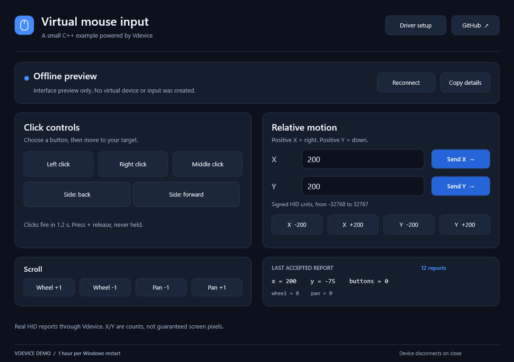

# Virtual Mouse Input - C++ Virtual USB Mouse Example

A small Windows application that creates a **virtual USB HID mouse** with
**[Vdevice](https://github.com/TitanCSA/Vdevice)** and sends real mouse reports.
The device connects automatically when the application opens and disconnects
when it closes. The interface and complete application source are included;
the kernel driver source is not.

**[Download](https://github.com/TitanCSA/Virtual-mouse-input/releases/latest)** |
[Vdevice driver and SDK](https://github.com/TitanCSA/Vdevice) |
[Build from source](#build-from-source)



An educational example of Vdevice's raw C++ API. The screenshot is an interface
preview; it is not a hardware compatibility or latency measurement.

## Install and run

1. Use **Windows 10/11 x64**. Download **VdeviceSetup.exe** and the application's
   **win64 ZIP** from the latest release.
2. Open **VdeviceSetup.exe**, accept elevation and choose **Install**. Restart
   Windows if the installer requests it.
3. Extract the application ZIP and open **VirtualMouseInput.exe**. Accept its
   administrator prompt; Vdevice restricts live device access to administrators.
4. Wait for **Ready**. Use the controls to send mouse input. Close the application
   to remove its virtual mouse.

**Driver setup** opens the bundled installer. Click buttons schedule a short
delay so you can move the pointer outside the window before the click is sent;
move it outside as prompted. Movement buttons send immediately.

The installer is the unchanged **Vdevice demo installer**, not another driver.
It installs the Microsoft-signed Vdevice driver package. Installer and application
EXEs have their own signature status; the driver's signature does not sign them.
If installation or enumeration fails, the application displays its diagnostic.

## Controls

| Control | Report sent |
| --- | --- |
| Left / right / middle / back / forward | A delayed button press followed by release |
| X / Y movement buttons | A relative movement of 200 or -200 units |
| Custom X / Y fields | Signed relative movement from -32768 to 32767 |
| Vertical / horizontal scroll | Mouse wheel or horizontal pan |

X and Y are **relative HID counts**, not absolute screen coordinates or guaranteed
pixels. Windows pointer speed, acceleration and the receiving application's
input handling determine the result. This application sends input through a
virtual device; it does not move the cursor with `SetCursorPos` or Windows `SendInput`.
Applications can distinguish virtual devices, and compatibility with every game
or protected application is not guaranteed.

## How the example works

[`App/Mouse.cpp`](App/Mouse.cpp) builds the USB and HID descriptors and encodes a
seven-byte report: five buttons, signed 16-bit X/Y, vertical wheel and horizontal
pan. These protocol details belong to the example; Vdevice itself remains a raw SDK.

The essential input operation is:

```cpp
VirtualMouse::State state;
state.x = 200;
auto sent = Vdevice::Send_Input(mouse, VirtualMouse::Endpoint,
                               VirtualMouse::Report(state));
if (!sent) {
    // sent.error is the Windows error code; sent.message explains the failure.
}
```

`mouse` is the object returned by `Vdevice::Create_Device(configuration)`.
The application keeps it alive, services host events during enumeration and
sends reports after Windows configures the device. A click sends a pressed
report and then a neutral report. Normal shutdown calls `Delete_Device`;
Vdevice also cleans up devices owned by a process that terminates unexpectedly.
The original physical mouse continues to work.

The descriptors use example VID/PID `FFFF:0010`; this is a development identity,
not an assigned production USB identity.

## Build from source

Install **Visual Studio 2022 Desktop development with C++**, a Windows SDK and
**CMake**. From the repository directory:

```powershell
powershell -ExecutionPolicy Bypass -File .\Build.ps1
```

The build produces the application and checks the interface offline.
It does not install a driver, create a virtual device or send input.

```text
App/       Application, mouse descriptors and report encoding
Vdevice/   Vdevice.h and Vdevice.cpp, the two-file raw SDK
docs/      Screenshot and binary distribution terms
```

The [Vdevice API documentation](https://github.com/TitanCSA/Vdevice/blob/main/docs/API.md)
explains descriptor construction, asynchronous enumeration, ownership and errors.
This repository includes **user-mode application/SDK source only**.

## Demo edition

The included driver allows **one hour per Windows kernel boot**, starting at the
first successful virtual-device creation and shared across Vdevice applications.
Sleep counts. Closing the application or reinstalling does not reset the timer.
Expiry disconnects virtual devices and rejects new creation/transfers until
Windows **Restart**. For the unrestricted edition, DM **`titancsa`** on Discord.

Application and SDK source are [MIT licensed](LICENSE). The prebuilt demo driver
and installer are distributed under [separate binary terms](docs/BINARY-LICENSE.txt).

## Responsible use

Created for lawful accessibility, testing, learning and software development.
Users are responsible for their actions, necessary authorizations and compliance
with laws and third-party rules. Illegal, malicious or unauthorized use is not
endorsed. To the extent permitted by law, TitanCSA and contributors provide the
software "AS IS", without warranties, and are not liable for misuse, damages or
other consequences of its use. Mandatory legal rights remain unaffected.
